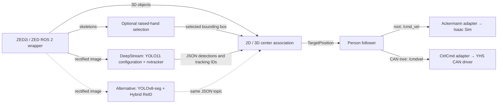

# Bicyclist Detection and Tracking for a Follow-me Function

A ROS 2 research prototype for connecting stereo perception, persistent person
tracking and mobile-robot following. Developed by Gökçer Sönmezocak during
Master's studies in Embedded Systems Engineering at FH Dortmund, Germany.

The engineering challenge is to carry a selected visual identity through
asynchronous 2D detections and stereo 3D positions into a vehicle command, while
managing embedded inference, occlusion and target loss. The implemented target
filter is **person**; the research title does not imply a separately validated
bicyclist classifier or bicycle–rider association.

**Status:** research implementation with simulation assets and historical camera/CAN
integration logs. Safe offline tests are reproducible. Full runtime reproduction
still requires missing vendor/configuration dependencies and the safety fixes
listed in the [engineering audit](docs/ENGINEERING_AUDIT.md).

## System at a glance



Choose one perception backend and one workspace. The two source trees contain
intentional differences; [architecture and topic contracts](docs/ARCHITECTURE.md)
explain them. The DeepStream path points to YOLO11 and NvDCF configuration files
outside this repository; the exact model variant and effective tracker settings
must still be recovered.

## Engineering contributions

- ROS 2 integration from stereo images and object/skeleton messages to custom
  target messages, follower commands and separate simulation/CAN outputs.
- ROS-image-to-GStreamer bridge with encoding conversion, a bounded frame queue,
  demand-driven buffer transfer and DeepStream metadata publication.
- Resolution-dependent association of 2D tracking IDs with ZED 3D positions,
  optional gesture selection and target-lock state.
- Integration of an alternative Hybrid ReID pipeline, plus simulation scenes,
  startup workflows and evidence of buffer/memory debugging.

These are system integration contributions. YOLO, NvDCF, DeepSORT, DINOv2,
Hybrid ReID's underlying algorithms, the ZED driver and vendor control code are
third-party work; see [provenance and publication constraints](docs/PUBLICATION.md).

## Explore the implementation

| Location | Purpose |
|---|---|
| [src/](src/) | Root workflow: perception, fusion, gesture, follower and Ackermann simulation adapter |
| [CAN_Combined_Pipeline/src/](CAN_Combined_Pipeline/src/) | Physical-camera/CAN integration variant, chassis interfaces/driver and experimental trajectory follower |
| [simulation/](simulation/) | Five historical Isaac Sim USD stages |
| [startup_scripts/](startup_scripts/) | Historical simulation startup scripts; known faults, not a turnkey entry point |
| [data/](data/) | Original experiment screenshots and recordings |
| [tests/](tests/) / [tools/](tools/) | Non-actuating regression tests and read-only inspection tools |

Both workflows use Python ROS 2 nodes and custom messages; the CAN transport is
C++/SocketCAN. The principal perception path uses GStreamer, NVIDIA DeepStream,
TensorRT and OpenCV. The experimental alternative uses Ultralytics
`yolov8n-seg.pt`, DeepSORT and DINOv2 `dinov2_vitb14_reg` (ViT-B/14 with registers),
with a ResNet50 fallback. Jetson deployment requires a verified SDK combination;
the checked-in logs do not establish Jetson performance.

## Demonstrations and evidence

The repository contains a [scene 1 simulation recording](data/test_scene_1/test_video_recording.mp4),
a [scene 2 recording](data/test_scene_2/test_video_recording.webm), and a
[scene 1 screenshot](data/test_scene_1/scene1_initial_cropped.png).
These are historical project artifacts, not newly reproduced demonstrations.
Scene-asset redistribution permissions still need confirmation before broader
publication; no new media or benchmark graphics were fabricated.

The saved camera log reports **1920×1080 acquisition configured at 30 FPS** and
**960×540 color/depth publication**. Across one ~43.66 s logged interval, the
follower records **6.345 command events/s**. That is a log-derived update rate,
not inference FPS or full-system latency. The report, synchronized benchmark
traces, Jetson power measurements and a complete memory-soak result are absent.
[Evaluation](docs/EVALUATION.md) defines the measurement boundaries and provides
the reproduction command.

## Reproduce the supported checks

From the repository root, using Python 3 and Bash:

```bash
PYTHONDONTWRITEBYTECODE=1 python3 -m unittest discover -s tests -v
python3 tools/summarize_log_rates.py
python3 tools/check_repository.py
```

The unit suite includes explicit expected failures for unresolved safety defects.
The repository checker currently exits **1** for the historical root startup
script's missing `fi`; this is an honest failure, not a passing deployment check.
None of these commands starts ROS, loads models or transmits CAN commands.

For separate simulation, Jetson perception and physical-robot prerequisites,
build paths and conditional execution instructions, read
[installation and reproduction](docs/INSTALLATION.md).

## Limitations and next work

This is a research prototype, not a certified autonomous-driving system. There
is no demonstrated complete obstacle-avoidance system. Stale detections,
multi-person association, non-finite targets, process-failure stopping and CAN
units need further work. The root startup script is broken; ZED gitlinks lack
URL mappings; model/tracker configs and license records are incomplete.

The [prioritized audit](docs/ENGINEERING_AUDIT.md) separates confirmed defects,
hardware-dependent questions and implemented safe corrections. It also defines
the proposed motion/interface changes that require approval before implementation.
