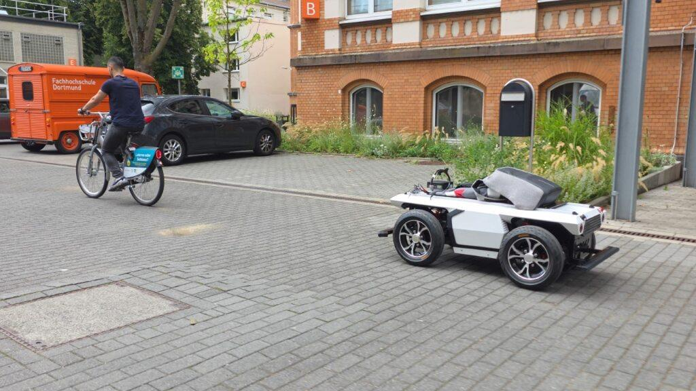
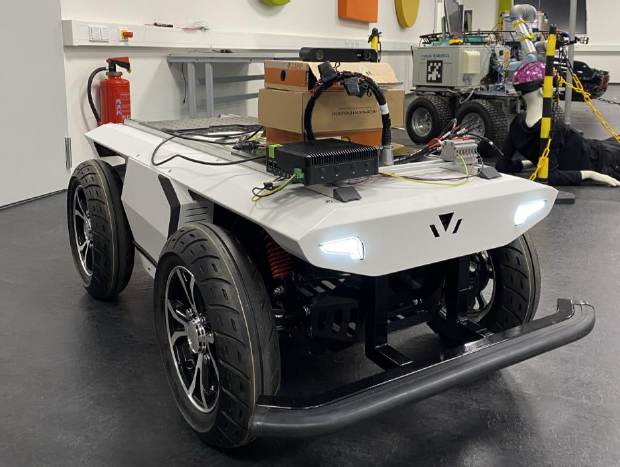
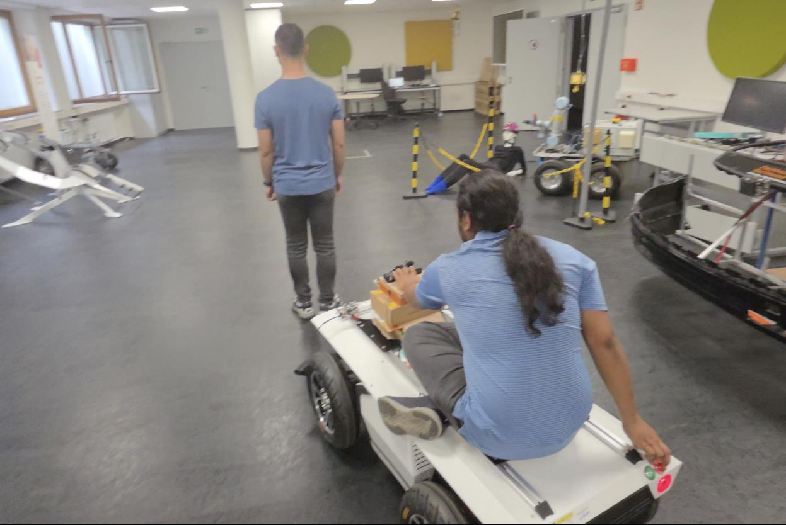
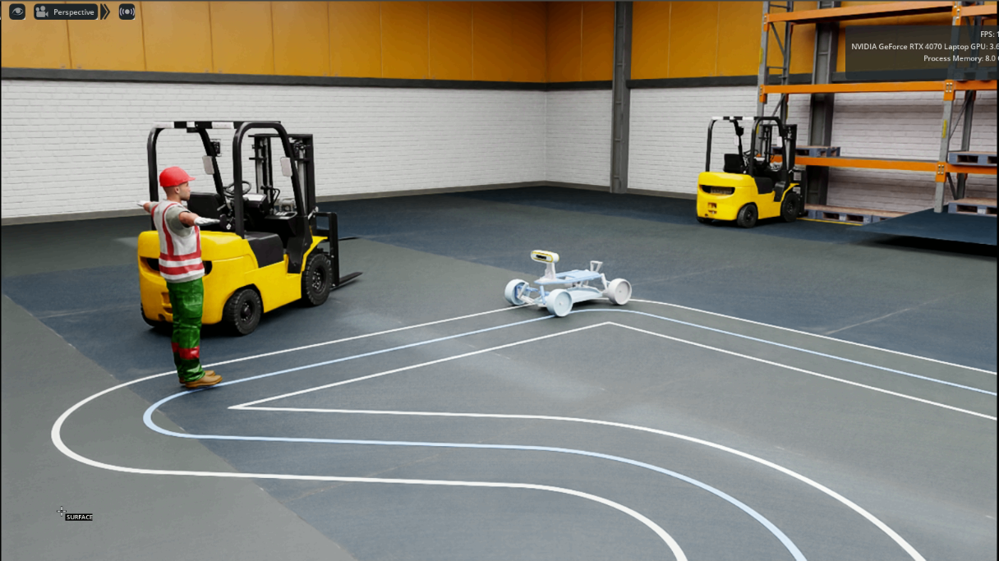
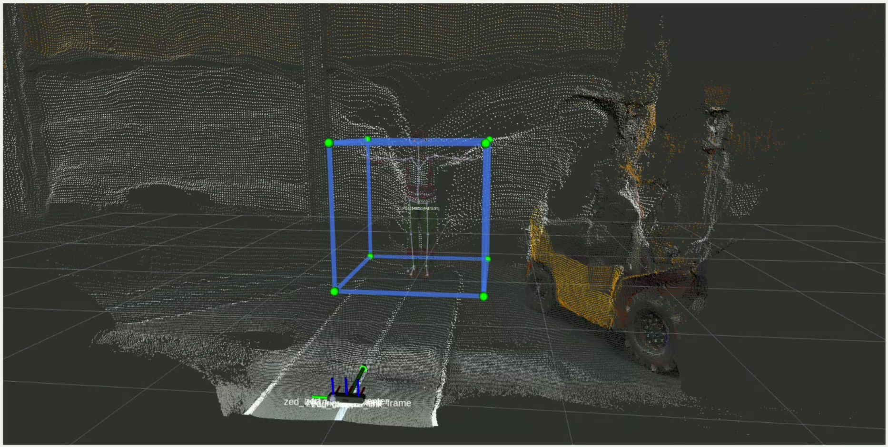
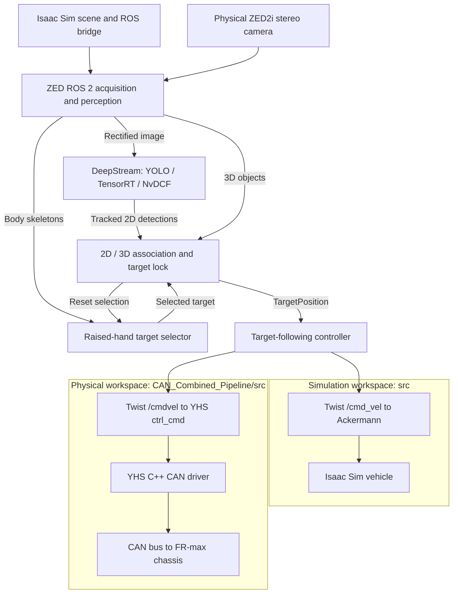

# Autonomous Cyclist-Following Robot
### ROS 2 | NVIDIA Jetson | DeepStream | Computer Vision | Sensor Fusion

An embedded vision system that turns camera observations into autonomous following commands on a **Yuhesen FR-max mobile robot**. I designed and integrated the ROS 2 pipeline from accelerated object detection and persistent tracking to stereo-based target localization, gesture selection and CAN-connected vehicle control.

Developed as a research project at **FH Dortmund**, the system was deployed on **NVIDIA Jetson Orin NX** and evaluated in **NVIDIA Isaac Sim** and supervised indoor and outdoor experiments.


*Original outdoor experiment, August 2025 research report, Figure 22. Straight-line cyclist following was demonstrated indoors and outdoors at low speed.*

[Architecture](docs/ARCHITECTURE.md) · [Technical contributions](docs/TECHNICAL_CONTRIBUTIONS.md) · [Engineering challenges](docs/ENGINEERING_CHALLENGES.md) · [Experimental results](docs/EXPERIMENTAL_RESULTS.md) · [Setup](docs/SETUP.md)

## Project highlights

- **Built the perception-to-control architecture:** modular ROS 2 nodes connect camera acquisition, tracking, target localization, selection and motion commands.
- **Deployed accelerated vision on Jetson Orin NX:** integrated YOLOv11 medium through NVIDIA DeepStream and TensorRT, with NvDCF tracking in the reported deployment.
- **Connected 2D identities to 3D positions:** associated tracked image detections with ZED2i stereo object measurements for target following.
- **Implemented gesture-based target selection:** a sustained raised hand selects a target; the selection/reset workflow supports retargeting during experiments.
- **Integrated two vehicle interfaces:** Ackermann commands for Isaac Sim and a ROS 2-to-CAN command adapter for the physical FR-max.
- **Demonstrated the complete system:** simulation tracking, indoor pedestrian following and low-speed cyclist following indoors and outdoors.

## System demonstration

| Physical research platform | Indoor following experiment |
|:---:|:---:|
|  |  |
| ZED2i stereo camera and Jetson Orin NX mounted on the FR-max. | Target tracking and following on the physical platform. |

| Isaac Sim environment | Stereo perception visualization |
|:---:|:---:|
|  |  |
| Custom simulation scene with a scaled robot model. | Point-cloud view with the localized target. |

**Recorded simulation demonstrations:** [scene 1 video](data/test_scene_1/test_video_recording.mp4) · [RViz point-cloud recording](data/test_scene_1/test_video_rviz_point_cloud.webm) · [multi-person scene video](data/test_scene_2/test_video_recording.webm).

See [experimental results](docs/EXPERIMENTAL_RESULTS.md) for the experiment descriptions, measurement scope and original figure provenance.

## System architecture



The simulation and physical workspaces share the perception design and use separate control adapters. Build and source **one workspace at a time**. The [architecture guide](docs/ARCHITECTURE.md) documents the actual topics, message contracts and component responsibilities.

## Technology stack

| Area | Technologies and role |
|---|---|
| Robotics middleware | **ROS 2 Humble**, Python/rclpy nodes, custom messages; C++ in the vendor CAN driver |
| Embedded platform | **NVIDIA Jetson Orin NX**, JetPack 6.1 / Ubuntu 22.04 in the reported deployment |
| Accelerated perception | **DeepStream 7.1**, GStreamer, CUDA, TensorRT, YOLOv11 medium, NvDCF |
| Stereo vision | **ZED2i**, ZED SDK and ROS wrapper, OpenCV / cv_bridge |
| Simulation | **NVIDIA Isaac Sim**, USD scenes, ROS bridge, Ackermann command interface |
| Vehicle integration | **Yuhesen FR-max**, YHS messages and CAN bus |
| Alternative perception experiment | PyTorch, YOLOv8 segmentation, DeepSORT and DINOv2 through a Hybrid ReID ROS wrapper |

The main deployment results refer to the DeepStream pipeline. The Hybrid ReID integration is a separate research alternative.

## My technical contributions

**System architecture.** I designed the ROS 2 component boundaries, topic flow and custom target message, integrating heterogeneous vision and vehicle components into a complete following system.

**Embedded AI.** I implemented the ROS image-to-GStreamer bridge and tracked-metadata publisher, configured the YOLO/DeepStream deployment, and integrated accelerated inference on Jetson. A bounded frame queue connects ROS callbacks to GStreamer buffer requests.

**Computer vision.** I implemented resolution-aware association between tracked 2D detections and ZED 3D object measurements, target locking, and a raised-hand selection state machine. I also integrated an alternative appearance-based ReID pipeline behind the detection topic.

**Robotics.** I implemented target-relative following commands and the Python adapter to the physical robot's YHS control messages, and integrated the simulation Ackermann path with the robot model.

**Engineering and debugging.** I investigated video-buffer behavior across ROS 2, GStreamer and Jetson, addressed unbounded input buffering, and used NVIDIA Nsight Systems to inspect GPU execution and memory-related behavior during integration.

My contribution is the system design, custom nodes and integration work. YOLO, TensorRT, NvDCF, ZED perception, the vendor CAN driver and the third-party ReID algorithms are credited components. See [technical contributions and attribution](docs/TECHNICAL_CONTRIBUTIONS.md).

## Engineering challenges and solutions

| Challenge | Engineering approach → implemented solution | Observed result |
|---|---|---|
| ROS 2 and DeepStream integration | Bridge ROS image callbacks into GStreamer `appsrc`; extract tracker metadata into ROS JSON messages. | Accelerated detections feed the same ROS target-localization and control chain used in experiments. |
| Real-time video buffering | Bound the input queue to five frames and discard the oldest waiting frame when full. | The report records that limiting buffering addressed the observed queue-related RAM growth. |
| Embedded inference deployment | Export YOLOv11 medium to ONNX, integrate the DeepStream custom parser, and build/load a TensorRT engine on Jetson. | The reported Orin NX system ran the perception-to-control pipeline during physical trials. |
| Stereo target localization | Match normalized 2D box centers across detector and ZED image scales. | A selected visual identity becomes a 3D `TargetPosition` for the follower. |
| Human–robot interaction | Detect a sustained raised hand and pass selection/reset events to fusion. | Field experiments used gesture-based retargeting without manually restarting the pipeline. |
| Vehicle actuation | Translate follower velocity commands into YHS control messages and connect the vendor CAN driver. | The FR-max demonstrated pedestrian and straight-line cyclist following. |

[Read the engineering case studies](docs/ENGINEERING_CHALLENGES.md) for implementation references and evidence.

## Performance and experimental results

Historical results from the author's **August 2025 research report**, with measurement scope preserved:

| Metric | Result | Meaning |
|---|---|---|
| Configured video input | **30 FPS** | GStreamer input caps; not measured neural-network throughput. |
| Control-command update frequency | **Approximately 14.5 Hz** | Reported from consecutive command-log timestamps; not a whole-run inference FPS benchmark. |
| Fusion-to-command processing | **Less than 2 ms** | Reported log-derived interval from fusion to control-command generation; excludes camera acquisition and upstream DeepStream processing. |
| Jetson memory observation | **Approximately 6.6 GB RAM** | Observed during the reported Orin NX run. |
| Jetson power observation | **Approximately 16.5 W** | Reported monitored system power, not inference-only power. |
| Physical demonstration | **Indoor and outdoor cyclist following** | Successful straight-line trials at low speed. |

[Experimental results](docs/EXPERIMENTAL_RESULTS.md) includes the timing and Jetson-monitor screenshots, retained-log analysis and experiment conditions.

## Real-world validation

- **Indoor pedestrian tracking:** followed the target with a consistent ID in the unobstructed trial; also retained it during the reported brief pedestrian occlusion.
- **Outdoor cyclist following:** demonstrated the integrated camera–Jetson–CAN–vehicle chain in a straight-line trial; indoor cyclist following was also reported.
- **Gesture interaction:** used target reselection during field testing to resume following without restarting the processing pipeline.
- **Isaac Sim testing:** the reported manually moved target retained its tracking ID along the test route with stationary distractors in the scene.

These were supervised research experiments. Their demonstrated scope is low-speed following; complex outdoor occlusion and high-speed cycling are outside the validated operating scope.

## Installation and usage

Start with [SETUP.md](docs/SETUP.md), which separates the runtime dependencies and commands for:

1. **Simulation:** root `src/` workspace, Isaac Sim and the Ackermann interface.
2. **Jetson perception:** ZED2i acquisition, DeepStream configuration and one selected detector backend.
3. **Physical robot:** `CAN_Combined_Pipeline/src/`, YHS messages and the CAN driver.

Offline checks and retained-log analysis can run without ROS or robot hardware:

```bash
PYTHONDONTWRITEBYTECODE=1 python3 -m unittest discover -s tests -v
python3 tools/summarize_log_rates.py
```

## Author

**Gökcer Sönmezocak**<br>
M.Eng. Embedded Systems Engineering<br>
FH Dortmund — University of Applied Sciences and Arts

Research focus: Embedded AI, Computer Vision, Robotics, ROS 2, NVIDIA Jetson and Autonomous Systems.

[GitHub — gokcerSnmzck](https://github.com/gokcerSnmzck)
