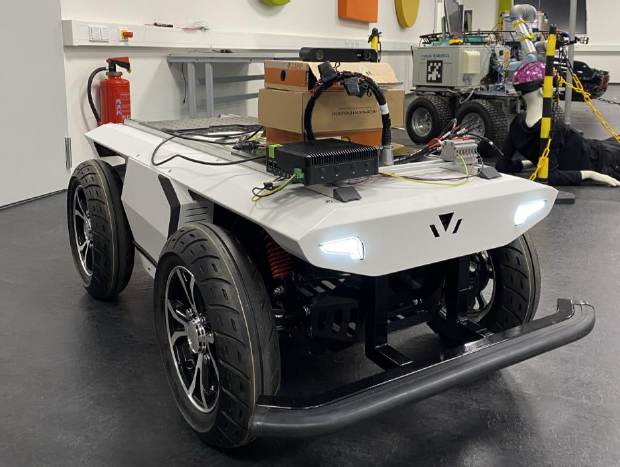
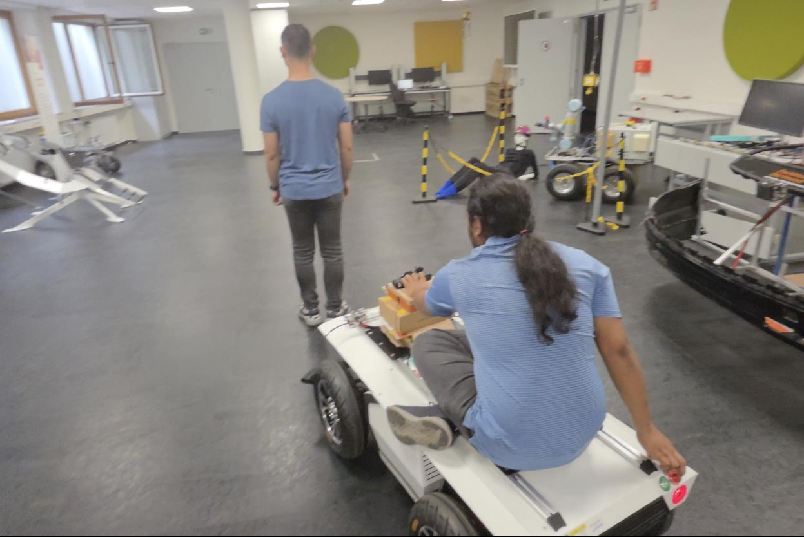
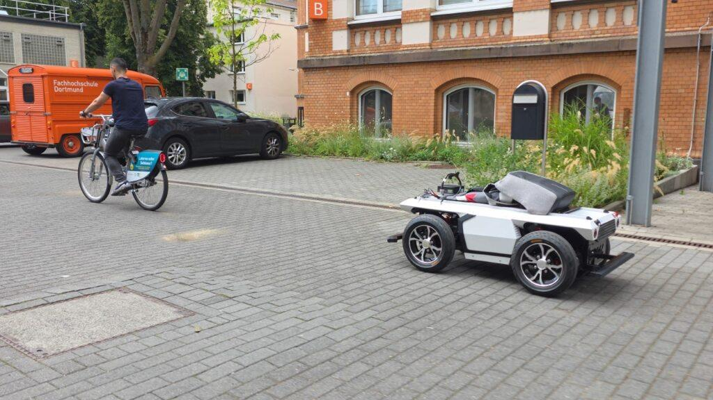
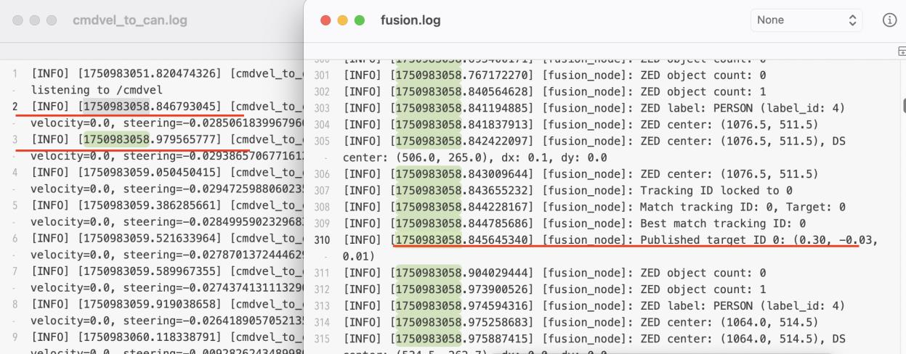
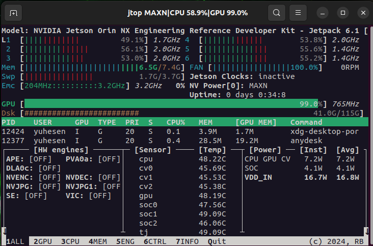

# Experimental results

[Project overview](../README.md) · [Architecture](ARCHITECTURE.md) · [Setup](SETUP.md)

The project was evaluated in **NVIDIA Isaac Sim** and on a **Yuhesen FR-max with ZED2i and Jetson Orin NX**. This page brings together the author's research report, original experimental figures, simulation recordings and retained runtime logs.

**Primary source:** Gökcer Sönmezocak, *Bicyclist Detection and Tracking for a Follow-me Function with a Mobile Robot*, Research Project Thesis, FH Dortmund University of Applied Sciences and Arts, August 2025. The references below use the report's printed page numbers. Selected original experimental figures are reproduced here; the complete report is not bundled with this repository.

## Demonstrated capabilities

| Experiment | Reported outcome | Conditions and evidence |
|---|---|---|
| Isaac Sim target following | The selected target retained its tracking ID along the described route. | Target moved manually through the scene; stationary distractors entered and left the camera field of view. Report pp. 44–47; [scene 1 recording](../data/test_scene_1/test_video_recording.mp4), [multi-person scene](../data/test_scene_2/test_scene_view.png). |
| Indoor pedestrian following | Maintained the target identity and followed the person. | Unobstructed initial trial; report p. 48 and Figure 21, p. 49. |
| Brief indoor occlusion | Retained the target during a short passing-person occlusion. | Another person briefly crossed between the camera and target. Report p. 49. |
| Indoor and outdoor cyclist following | Successfully followed a cyclist along a straight line. | Low-speed trials; camera alignment adjusted to keep the cyclist visible at distance. Report p. 50. |
| Gesture-based retargeting | Reselected a target and resumed following without restarting the pipeline. | Practical field-test interaction described on p. 56; implemented raised-hand selector and fusion reset path. |

These are individual research demonstrations, not aggregate success-rate or safety-certification results. The report's longer outdoor multi-person occlusion test included target loss/misassociation (p. 49), so the successful straight-line trials do not establish robust following through complex outdoor occlusion or at high cycling speeds.

## Physical platform and experiments


*Figure 20, p. 48: ZED2i and Jetson Orin NX mounted on the FR-max. CAN connects the processing platform to the chassis; an Ethernet-connected laptop supported debugging.*

| Indoor target following | Outdoor cyclist following |
|:---:|:---:|
|  |  |
| Figure 21, p. 49. | Figure 22, p. 50. |

## Timing and throughput

| Quantity | Historical result | Measurement scope |
|---|---|---|
| Configured camera/video input | **30 FPS**, 960 × 540 BGRA input caps | Configuration in the DeepStream ROS node, not measured inference throughput. |
| Control-message update frequency | **Approximately 14.5 Hz** | Report p. 51: derived from consecutive `cmdvel_to_can` log timestamps. Treat as the reported interval-based observation, not a whole-run average. |
| Fusion-to-control-command processing interval | **Less than 2 ms** | Report p. 51: log-derived interval between fusion output and control-command generation. Excludes camera acquisition and upstream DeepStream processing. |


*Figure 23, p. 51: original timing evidence. The report calls this “end-to-end latency”; the portfolio uses the narrower fusion-to-command description because the upstream camera/inference interval was not measured. Log proximity is not a hardware-synchronized, per-frame latency measurement.*

### Retained-log analysis

The repository also includes captured logs in [`CAN_Combined_Pipeline/startup_scripts/`](../CAN_Combined_Pipeline/startup_scripts). The reproducible [log-rate tool](../tools/summarize_log_rates.py) measures the complete matched timestamp span using `(N − 1) / (last − first)`:

```bash
python3 tools/summarize_log_rates.py
```

| Log stream | Matched messages | Span | Whole-span rate | Median adjacent interval |
|---|---:|---:|---:|---:|
| Fusion output | 278 | 43.657 s | 6.345 messages/s | 71.650 ms |
| Follower output | 278 | 43.656 s | 6.345 messages/s | 71.557 ms |
| CAN adapter output | 280 | 43.657 s | 6.391 messages/s | 71.840 ms |

The retained trace's full-span rates and the report's approximately 14.5 Hz interval-based observation use different aggregation scopes. Their exact run correspondence is not established. The median CAN interval corresponds to about 13.9 updates/s locally, while longer gaps reduce the full-span rate. Neither measure is detector inference FPS. These logs are not sufficient to derive synchronized camera-to-actuation latency.

The captured DeepStream log also records fallback to tracker defaults when a configuration could not be read in that run. The report describes NvDCF deployment; the resource and timing observations should not be read as a controlled comparison of tracker configurations.

## Jetson Orin NX resource observations

The report's runtime monitoring gives a view of the embedded system under the experimental workload (p. 52). These are approximate observations, rather than an isolated neural-network benchmark or a long-duration thermal test.

| Resource | Reported observation |
|---|---|
| GPU | Approximately 99% utilization at 765 MHz |
| CPU | Approximately 29–60% utilization |
| RAM | Approximately 6.6 GB |
| Swap | Approximately 1.7 GB |
| Monitored system power | Approximately 16.5 W |
| Temperature | Approximately 50 °C with the reported passive cooling arrangement |


*Figure 24, p. 52: original Jetson monitoring capture. Rounded report values summarize observations during the run; individual displayed readings vary.*

## Simulation artifacts

| Artifact | What it shows |
|---|---|
| [Scene overview](../data/test_scene_1/scene1_initial_cropped.png) | Robot and target in the simulation environment. |
| [RViz perception view](../data/test_scene_1/scene1_rviz_pointcloud.png) | Point cloud and target bounding box. |
| [Scene 1 video](../data/test_scene_1/test_video_recording.mp4) | Retained simulation demonstration recording. |
| [RViz video](../data/test_scene_1/test_video_rviz_point_cloud.webm) | Retained spatial-perception recording. |
| [Scene 2 video](../data/test_scene_2/test_video_recording.webm) | Retained multi-person simulation recording. |
| [USD scenes](../simulation) | Scene and robot-integration artifacts for Isaac Sim. |

The videos and scene files are retained project artifacts; no claim is made that a particular saved USD revision exactly reproduces each recorded run.

## Figure provenance

All new images in [`docs/media/`](media) come from the author's original experimental figures in the August 2025 report. The platform photo was rendered from the page in its displayed orientation; the remaining figures were extracted directly. No synthetic demonstrations were added, and third-party product illustrations from the report were not copied.

| Repository asset | Report location |
|---|---|
| [Robot platform](media/robot-platform.png) | Figure 20, p. 48 |
| [Indoor experiment](media/indoor-following.jpg) | Figure 21, p. 49 |
| [Outdoor cyclist experiment](media/cyclist-following.jpg) | Figure 22, p. 50 |
| [Timing evidence](media/fusion-control-timing.jpg) | Figure 23, p. 51 |
| [Jetson monitoring](media/jetson-resources.png) | Figure 24, p. 52 |
| [Nsight profiling](media/nsight-timeline.jpg) | Figure 26, p. 55 |
