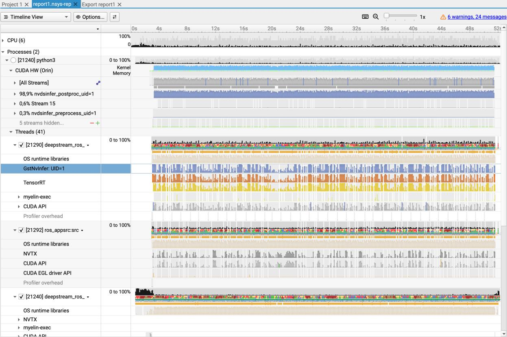

# Technical contributions

[Project overview](../README.md) · [Architecture](ARCHITECTURE.md) · [Engineering challenges](ENGINEERING_CHALLENGES.md) · [Results](EXPERIMENTAL_RESULTS.md)

**Author: Gökcer Sönmezocak.** My central contribution is an integrated embedded robotics system: connecting accelerated visual perception, stereo localization, target interaction and vehicle commands through explicit ROS 2 interfaces. The research report describes the system design and deployment; the source links below expose the implementation.

## 1. Modular perception-to-control architecture

I divided the application into independently running components for DeepStream processing, fusion, gesture selection, following and vehicle adaptation. I defined the data flow between them and the custom target output carrying identity, classification, confidence and 3D position.

This separates the visual identity problem from spatial localization and motion generation. It also supports the simulation and physical-robot workflows through distinct command adapters while retaining the common perception design.

**Implementation:** [target interface](../src/detection_msgs/msg/TargetPosition.msg), [fusion node](../src/fusion_node/fusion_node.py), [follower](../src/person_follower_pkg/person_follower_pkg/person_follower.py). The [architecture guide](ARCHITECTURE.md) maps the components to their actual message contracts.

## 2. DeepStream integration and embedded inference

I implemented the ROS-side image and metadata integration around NVIDIA's processing stack:

- Convert supported ROS image encodings into the BGRA input expected by the pipeline.
- Decouple ROS callbacks from GStreamer buffer requests using a bounded queue.
- Build the GStreamer processing chain around stream multiplexing, inference, tracking and display.
- Extract tracker IDs, boxes, classes and confidence from DeepStream metadata and publish them to ROS.
- Support a display or `fakesink` output through the `enable_visualization` parameter.

For the reported Jetson deployment, I configured the YOLOv11 medium export/inference workflow: ONNX conversion, the DeepStream-Yolo custom parser and TensorRT engine creation/loading on the target. The August 2025 report identifies Jetson Orin NX, JetPack 6.1 and DeepStream 7.1 as the deployed platform.

**Implementation:** [DeepStream ROS node](../src/deepstream_ros_node_json/deepstream_ros_node_json/deepstream_ros_node_json.py) and its [physical-workspace counterpart](../CAN_Combined_Pipeline/src/deepstream_ros_node_json/deepstream_ros_node_json/deepstream_ros_node_json.py). **Research evidence:** report pp. 27–29 and 48–52.

The original contribution is the ROS integration and deployment work. The YOLO model, inference runtime, GStreamer plugins and NvDCF algorithm are third-party components.

## 3. Visual identity associated with 3D position

I implemented the association between detector/tracker metadata and ZED spatial object measurements. The fusion node accounts for the image-coordinate scale difference, compares normalized bounding-box centers and selects a nearby ZED object for the tracked identity. Target locking makes the selected identity available to downstream following rather than treating every detection as an independent command source.

The result is a compact target message that the controller can consume without depending directly on DeepStream's metadata structures or ZED's complete object list. The association uses the latest available observations; its output timestamp denotes publication, rather than synchronized image acquisition.

**Implementation:** [fusion logic](../src/fusion_node/fusion_node.py). **Demonstration:** [RViz spatial-perception view](../data/test_scene_1/scene1_rviz_pointcloud.png) and the reported following experiments.

## 4. Gesture selection and retargeting

I implemented a raised-hand selector using ZED skeleton joints, a duration threshold and a selection state machine. Requiring a sustained gesture provides a deliberate selection signal. Selection and reset events connect the human interaction to the fusion node's target lock.

The report describes using gesture-based retargeting during field tests to resume following after target loss without manually restarting the full pipeline. This is an explicit interaction mechanism; it is distinct from automatic appearance-based re-identification.

**Implementation:** [gesture selector](../src/gesture_selector/gesture_selector/gesture_selector.py), with `USE_GESTURE_DETECTOR` controlling fusion's selection mode. **Research evidence:** report p. 56.

## 5. Following control and physical vehicle integration

I implemented the target-relative following logic and the Python translation from ROS velocity commands to YHS control messages. I integrated that adapter with the supplied CAN driver, which handles serialization and chassis feedback. In parallel, I integrated the existing Ackermann conversion component with the simulation workflow and scaled robot model.

The complete physical chain connected ZED2i and Jetson Orin NX to the FR-max through CAN. The report documents indoor pedestrian following and successful straight-line cyclist following indoors and outdoors.

**Implementation:** [physical follower](../CAN_Combined_Pipeline/src/person_follower_pkg/person_follower_pkg/person_follower.py), [ROS-to-YHS adapter](../CAN_Combined_Pipeline/src/cmd_vel_to_can_node/cmd_vel_to_can_node/cmd_vel_to_can_node.py), [vendor CAN driver](../CAN_Combined_Pipeline/src/mk-01/yhs_can_control/src/yhs_can_control_node.cpp). **Research evidence:** report pp. 48–50.

## 6. Buffer management, profiling and integration debugging

I investigated memory growth at the ROS-to-GStreamer boundary and applied bounded buffering. The current queue holds five frames and removes the oldest waiting frame when full. The report records that limiting the queue addressed the observed buffer-accumulation behavior.

I also used **NVIDIA Nsight Systems** to examine GPU activity and buffer-conversion behavior on Jetson. The retained profiling figure documents this investigation; it does not establish that every Jetson conversion issue was resolved.

*Original profiling capture from the research report, Figure 26, p. 55.*

**Implementation:** bounded queue and GStreamer buffer construction in the [DeepStream node](../src/deepstream_ros_node_json/deepstream_ros_node_json/deepstream_ros_node_json.py). **Research evidence:** report pp. 54–55.

## 7. Simulation and alternative perception research

I integrated custom Isaac Sim scenes and a scaled vehicle model with the ROS following pipeline. The reported simulation test used a manually moved target and stationary distractors; the selected identity was maintained along the described route.

I additionally wrapped a Hybrid ReID approach behind the detection topic to explore appearance-based identity handling using YOLOv8 segmentation, DeepSORT and DINOv2. This provides an alternative research path; the main physical performance results belong to the DeepStream deployment.

**Artifacts:** [simulation stages](../simulation), [recorded simulation](../data/test_scene_1/test_video_recording.mp4), [Hybrid ROS wrapper](../src/hybrid_reid_ros_node/README.md). **Research evidence:** report pp. 44–47.

## Third-party components and attribution

| Component | Attribution and contribution boundary |
|---|---|
| ROS 2 | Middleware, communication and package/build infrastructure; project-specific node orchestration and interfaces are the integration work described above. |
| NVIDIA DeepStream, TensorRT, CUDA and NvDCF | Accelerated processing, inference and tracking infrastructure; integrated through the project's ROS/GStreamer node. |
| YOLO / Ultralytics | Detection models and associated tooling; model architecture is not claimed as original work. |
| DeepStream-Yolo | Custom YOLO inference integration tooling used in the reported deployment; [upstream project](https://github.com/marcoslucianops/DeepStream-Yolo). |
| Stereolabs ZED | Camera SDK, ROS wrapper, stereo localization and skeleton tracking; the project contributes association and selection logic around those outputs. |
| Hybrid ReID, DeepSORT and DINOv2 | [Hybrid ReID](https://github.com/rvxfahim/Hybrid_reID), [deep-sort-realtime](https://github.com/levan92/deep_sort_realtime) and [DINOv2](https://github.com/facebookresearch/dinov2); the contribution is their ROS integration and experimentation. |
| YHS / FR-max components | Vendor CAN driver, messages and robot assets; the project integrates them with the following controller. |
| Isaac Sim and Ackermann adapter | NVIDIA simulation ecosystem and existing conversion code; the project contributes scene/vehicle integration and experiment workflows. |

Existing source headers, package notices and dependency/model terms remain applicable. In particular, the Ackermann adapter retains its NVIDIA proprietary notice. This portfolio documentation does not grant a repository-wide license or replace third-party permissions.
